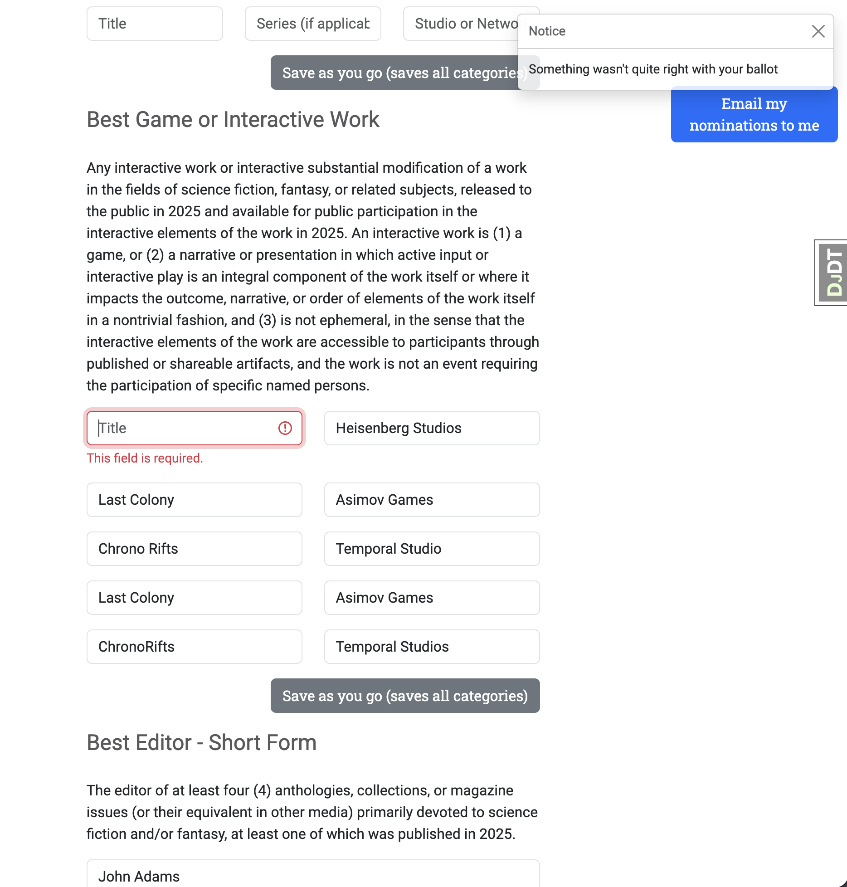

# NomNom shows green checks after a successful save

## Overview

NomNom is an open-source tool that lets Worldcon members submit nominations for the Hugo Awards. After I cleared the first Title and clicked Save as you go, the form showed “This field is required” next to Title and a green checkmark beside Developer. I passed the save result from the nomination view to the template. When a save fails, the form uses a renderer that keeps the red field errors visible. After a successful save, the form uses its original checkmark styling. I ran NomNom’s nomination view tests locally. All 59 passed in 2.89 seconds. [PR #537](https://github.com/WorldconVotingSystems/nomnom/pull/537) is open for review.

## What happened

I opened the nomination form on my own computer and went to the Best Game or Interactive Work category. I cleared the Title, left Heisenberg Studios in the Developer field, and clicked **Save as you go**. The form showed “This field is required” next to Title, but Developer still had a green checkmark. When I refreshed the page, the original title, *The Quantum Paradox*, came back. That showed me the form hadn’t saved my change.

The form was checking each field on its own. Developer had a value, so it got a green checkmark even though the blank Title blocked the save. I passed the save result from the view to the template so the form could keep showing field errors and only show green checkmarks after a successful save.

I tried saving again with Title blank. The Title error still showed up, and the green checkmark beside Developer was gone. Then I filled in Title and saved again. Both fields showed green checkmarks.

When I ran ship-gate, NomNom’s lint check stopped on this message:

> Would reformat: src/nomnom/nominate/renderers.py

I ran Ruff to format the file, then ran ship-gate again. Both `just lint` and `just test` passed. After that, I pushed the formatting fix to PR #537.

## Limitations and what's next

I checked the green checkmarks by hand in my browser. Next, I’d add an automated test that checks for the Title error and makes sure Developer has no green checkmark when a blank Title blocks the save.

